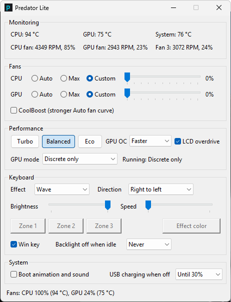
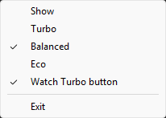

# Predator Lite

A tiny, open-source replacement for **Acer PredatorSense** on Windows: fan control and fan
curves, Turbo / Balanced / Eco modes, GPU overclock and GPU mode, keyboard lighting and the
laptop's other firmware settings, in one ~460 KB program with no services, no drivers and no
runtime.

[](https://github.com/yavcsd/predator-lite/actions/workflows/ci.yml)
[](LICENSE)


> [!WARNING]
> ## This project was developed with Claude Code
>
> Predator Lite was written with [Claude Code](https://claude.com/claude-code), Anthropic's AI
> coding assistant. The code, the firmware research, the tests and this documentation were
> produced with AI assistance. Everything was tested on one laptop, an Acer Predator Triton 500
> (PT515-51), and only on that one.
>
> Predator Lite changes fan, power and firmware settings. Read the code if you want to be sure of
> what it does, keep an eye on temperatures the first time you use it, and use it at your own
> risk. As the [license](LICENSE) says, it comes with no warranty.

<p align="center"></p>

> Predator Lite is an independent project. It is not made, endorsed or supported by Acer.
> "Acer", "Predator" and "PredatorSense" are trademarks of Acer Inc.

## Contents

- [Why Predator Lite](#why-predator-lite)
- [Features](#features)
- [Supported laptops](#supported-laptops)
- [Quick start](#quick-start)
- [Guides](#guides)
- [Building from source](#building-from-source)
- [Contributing](#contributing)
- [License](#license)

## Why Predator Lite

| | PredatorSense 3 | Predator Lite |
|---|---|---|
| Download / install size | ~250 MB (UWP app, 2 MSIs, services, drivers) | one ~460 KB `.exe` |
| Background processes | service + agent + admin agent + app | 1 process, in the tray |
| Memory when idle | tens of MB | about 3 MB |
| CPU when idle | several always-running processes | 0 % (it waits for Windows messages) |

- **Small and self-contained.** One native executable. No .NET, Python, Electron or Visual C++
  runtime, no Windows service, no kernel driver, no changes to the boot chain.
- **Uses only Acer's own firmware interface.** Every setting goes through the BIOS's WMI methods
  (`AcerGamingFunction`, `APGeAction`), the same ones PredatorSense calls. It never writes raw
  embedded-controller registers and never loads a third-party driver such as WinRing0 or PawnIO.
- **Careful with your hardware.**
  - Each setting is read first and written only when it differs. The firmware treats some
    repeated writes as a Turbo button press.
  - A change the firmware rejects is rolled back.
  - With no settings file yet, the app only reads the hardware and changes nothing.
  - If a temperature can't be read during Balanced or Eco, the fans go back to the firmware's
    own Auto.
  - No fan curve is left running without the app: exiting from Balanced or Eco puts the fans
    back on Auto and removes Eco's limits. Other fan settings (Auto, Max, Custom, Turbo) are kept
    by the firmware itself.
  - Settings that the BIOS setup can also change are read from the firmware instead of being
    overwritten.
- **Honest fan numbers.** The firmware's "custom fan %" is not a duty cycle: 60 % runs the CPU fan
  at 35 %. Predator Lite converts through a table measured on real hardware, so every percentage
  you see or set is the fan's real duty, and the readout next to each RPM confirms it.
- **Built from the original, verified on hardware.** The firmware calls were reverse-engineered
  from PredatorSense itself and checked one by one on a real laptop. That includes details other
  tools get wrong: LCD overdrive vs. boot animation, the keyboard effect layout, and the
  backlight timeout selector. See [docs/firmware-interface.md](docs/firmware-interface.md).
- **Quirks handled.**
  - The Turbo button sends Windows no event, so the app watches the firmware flag cheaply.
  - The PredatorSense button can open the app even when it is closed.
  - The firmware's GPU-level Turbo is treated as Turbo mode, so a saved preference can never
    switch Turbo back on by itself.
- **Tested and inspectable.**
  - More than 250 unit tests run against a simulated firmware.
  - `--status` writes a read-only hardware report.
  - An optional debug log records what the app does.

## Features

**Monitoring**
- CPU, GPU and system temperatures.
- RPM and real duty cycle (%) of all three fans.
- Refreshed every 2 s, and only while the window is visible.

**Fans**
- Auto, Max or Custom (0–100 % duty) for the CPU and the GPU fans.
- **CoolBoost**: Acer's stronger Auto fan curve.

**Performance modes**, one at a time:
- **Turbo**: Turbo LED on, firmware turbo flag set, fans at Max, GPU overclock at Turbo. Turning
  it off restores your fan and GPU settings. The physical Turbo button works too.
- **Balanced**: full performance with a quiet software fan curve. The fans are off below 60 °C
  and reach 100 % at 92 °C.
- **Eco**: Turbo Boost off through a separate power plan (your own plan is never changed), a GPU
  clock cap through `nvidia-smi`, and a fan curve that is off below 65 °C and reaches 100 % at
  90 °C.

**GPU and display**
- GPU overclock: Normal, Faster or Turbo, using the offsets the firmware provides.
- **GPU mode (MUX)**: Hybrid (Optimus) or Discrete only. It applies after a restart, which the
  app can do for you.
- LCD overdrive.
- Battery rule (the same as PredatorSense): on battery or below 30 %, Turbo turns off and the GPU
  overclock pauses. The overclock comes back on AC at 40 %; Turbo stays off until you turn it on.

**Keyboard**
- Zone RGB (up to 4 zones; the PT515-51 has 3) with Static colors per zone and the Breathing,
  Neon, Wave, Shifting and Zoom effects.
- Brightness, speed, direction and the effect color.
- **Win key** lock: turns the Windows and Menu keys off, e.g. while gaming.
- **Backlight off when idle**: Never, 30 s, 1 min or 2 min.

**System**
- Boot animation and sound.
- **USB charging when off**: powers the USB ports while the laptop is off, until the battery
  falls to 10, 20 or 30 %.

**Hardware buttons and tray**
- **Turbo button**: works like the Turbo button in the window.
- **PredatorSense button**: opens or hides the window. With a one-time setup it also starts the
  app when it is closed.
- Tray icon with a quick menu: modes, the Turbo-button watcher and Exit. Closing the window only
  hides it to the tray.
- Settings are saved to `%APPDATA%\PredatorLite\settings.ini` and restored at start and after
  sleep.

<p align="center"></p>

## Supported laptops

| Laptop | Status |
|---|---|
| **Acer Predator Triton 500 (PT515-51)**, BIOS V1.13, Windows 11 | **Tested.** Every feature was used on this laptop, and almost every firmware write was checked by reading it back. The [verification status](docs/firmware-interface.md#verification-status) lists the exceptions. |
| Other Acer Predator / Helios / Triton / Nitro models from about 2018 to 2021 with a zone-lit keyboard | **Likely to work, not tested.** These use the same firmware interface. Features the firmware doesn't offer are detected at start and greyed out. |
| Models with a per-key RGB keyboard | Keyboard lighting won't work: those keyboards are driven over USB, not through the BIOS. Everything else may. |
| Newer models (about 2022 on, e.g. Helios Neo) that switch performance modes through a "platform profile" | Not supported yet. Fans, monitoring and some settings may still work. |

Two things were measured on the PT515-51 and may differ on other models:
- **Fan duty conversion:** another model's fans may run a little faster or slower than the
  percentage shown. The duty readout shows the real value.
- **PredatorSense button scan code.**

**Help add your laptop.** In a command prompt in the Predator Lite folder, run
`predator-lite.exe --status report.txt` (it only reads the hardware). Accept the administrator
prompt, then open an issue with `report.txt` and your model name.

**Known limitations**
- The executable is not code-signed, so Windows SmartScreen may warn on the first start
  ("Windows protected your PC" > **More info** > **Run anyway**).
- The firmware can't report the keyboard effect, so the window shows Static at first. The
  lighting itself is left untouched until you change it in the app. See
  [first start](docs/installation.md#first-start).
- Eco's GPU cap needs `nvidia-smi.exe` in `System32`, where NVIDIA's driver installs it.

## Quick start

1. Download `predator-lite.zip` from [Releases](https://github.com/yavcsd/predator-lite/releases)
   and unzip it somewhere permanent, e.g. `C:\Tools\Predator Lite`. You can also
   [build it yourself](#building-from-source).
2. **Exit PredatorSense** if it is installed. Two programs controlling the same fans fight each
   other. See [Installation](docs/installation.md#coming-from-predatorsense).
3. Run `predator-lite.exe` and accept the administrator prompt. The firmware only answers
   administrators. The window opens and an icon appears in the tray.
4. Change what you like. Your choices are saved and applied again at every start. Until you
   change something, Predator Lite only reads the hardware.
5. Optional:
   - Start it with Windows: [Start at logon](docs/installation.md#start-at-logon).
   - Make the PredatorSense button open it:
     [PredatorSense button setup](docs/predatorsense-button.md).

```
predator-lite.exe                  open the window (and the tray icon)
predator-lite.exe --hidden         start in the tray only
predator-lite.exe --toggle         show or hide a running instance, or start with the window open
                                   (used by the button setup)
predator-lite.exe --status FILE    write a read-only hardware report
```

## Guides

| Guide | What it covers |
|---|---|
| [Installation](docs/installation.md) | Requirements, first start, start at logon, updating, uninstalling |
| [User guide](docs/user-guide.md) | Every control in the window, the modes and fan curves, tray, troubleshooting |
| [PredatorSense button](docs/predatorsense-button.md) | Make the button open Predator Lite, even when it is closed |
| [Settings file](docs/settings-file.md) | Every key in `settings.ini`, including editable fan curves |
| [Firmware interface](docs/firmware-interface.md) | The decoded Acer WMI calls, for developers and other tools |
| [Developer guide](docs/developer-guide.md) | Code layout, tests, research tools, adding a laptop model |

## Building from source

You need [Rust](https://rustup.rs) (stable, MSVC toolchain) on Windows 10/11.

```
git clone https://github.com/yavcsd/predator-lite.git
cd predator-lite
cargo test             # unit tests against a simulated firmware: no admin rights, no hardware access
cargo build --release  # target\release\predator-lite.exe
```

The executable links the C runtime statically and asks for administrator rights through its
manifest. More in the [developer guide](docs/developer-guide.md).

## Contributing

Bug reports, `--status` reports from other models and pull requests are welcome. Please read the
[developer guide](docs/developer-guide.md) first. In short:
- Run `cargo fmt`, `cargo test` and `cargo clippy --all-targets` before opening a pull request.
- New firmware writes need a read-back check on real hardware.

Thanks to the people who documented Acer's interface before:
[acer-wmi](https://github.com/torvalds/linux/blob/master/drivers/platform/x86/acer-wmi.c) in the
Linux kernel, and the many community PredatorSense / NitroSense alternatives.

Changes are listed in the [changelog](CHANGELOG.md).

## License

[MIT](LICENSE). Predator Lite contains no Acer code. It talks to the firmware interface that the
laptop's BIOS exposes to Windows.
